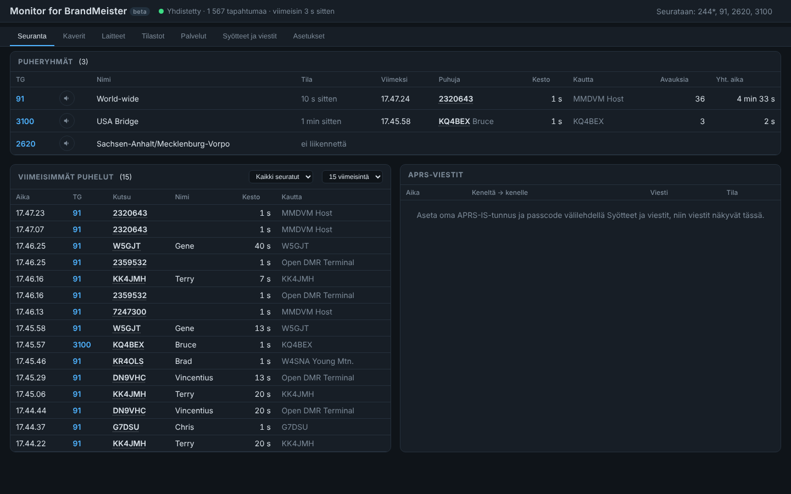

# Monitor for BrandMeister

**Epävirallinen työpöytäsovellus [BrandMeister](https://brandmeister.network)-DMR-verkon seurantaan.**
Seuraa puheryhmien liikennettä reaaliajassa, kuuntele ryhmiä, saa hälytys kun kaveri tulee taajuudelle,
valvo toistimia ja hotspotteja sekä vastaanota sää-, avaruussää-, liikenne- ja muita avoimen datan
hälytyksiä suoraan DMR-radioosi APRS:n kautta.

🇬🇧 [English README](README.md)

> [!NOTE]
> **Beta-versio.** Ydinominaisuudet on testattu oikeaa BrandMeister-verkkoa vastaan, mutta osaa
> ominaisuuksista on testattu vain rajoitetusti. Virheilmoitukset ja palaute:
> [Issues](https://github.com/hannulma/monitor-for-brandmeister/issues).



## Lataus ja asennus

Lataa uusin versio **[Releases](https://github.com/hannulma/monitor-for-brandmeister/releases)**-sivulta:

| Käyttöjärjestelmä | Tiedosto |
|---|---|
| Windows 10/11 | `MonitorForBrandMeister-<versio>-windows-setup.exe` (asennusohjelma) tai `…-windows-portable.zip` (ilman asennusta) |
| macOS 11+ (Intel ja Apple Silicon M1–M4) | `MonitorForBrandMeister-<versio>-macos-universal.dmg` |
| Linux x86_64 | `MonitorForBrandMeister-<versio>-linux-x86_64.tar.gz` |
| Python 3.9+ (mikä tahansa käyttöjärjestelmä) | `monitor_for_brandmeister-<versio>-py3-none-any.whl` |

Ohjelma käynnistää koneellesi pienen paikallisen palvelimen ja avaa käyttöliittymän selaimeen osoitteeseen
`http://127.0.0.1:8765/`. Mitään ei avata verkkoon. Jos ohjelma on jo käynnissä, uusi käynnistys vain avaa
sivun. Ohjelma suljetaan kohdasta **Asetukset → Sulje ohjelma**.

### Ensimmäinen käynnistys

Ohjelmia ei ole allekirjoitettu (allekirjoitusvarmenteet maksavat), joten käyttöjärjestelmä varoittaa:

- **Windows:** SmartScreen näyttää *"Windows suojasi tietokonettasi"* → **Lisätietoja → Suorita silti**.
  Asennusohjelma ei vaadi järjestelmänvalvojan oikeuksia, ja siinä voi valita käynnistyksen Windowsin mukana.
- **macOS:** avaa `.dmg` ja vedä ohjelma *Ohjelmat*-kansioon. Ensimmäisellä käynnistyksellä macOS estää
  avaamisen → **Järjestelmäasetukset → Tietosuoja ja turvallisuus → Avaa silti** (tai oikea klikkaus → *Avaa*).
- **Linux:** `tar xzf MonitorForBrandMeister-*.tar.gz && ./monitor-for-brandmeister/monitor-for-brandmeister`

### Asennus pipillä

```
pip install monitor_for_brandmeister-<versio>-py3-none-any.whl
monitor-for-brandmeister        (tai: python -m bmmonitor)
```

Valitsimet: `--port 9000`, `--no-browser`, `--demo` (keksitty testiliikenne), `--diag` (näyttää mitä
BrandMeister lähettää), `-v` (enemmän lokia).

## Välilehdet

### Seuranta
- **Puheryhmät:** lähetys juuri nyt (vihreä LÄHETYS), viimeisin yhteys, puhuja, kesto, toistin/hotspot,
  avausten määrä ja yhteenlaskettu puheaika. Kaiutinpainike aloittaa ryhmän **kuuntelun** (useita ryhmiä
  voi kuunnella yhtä aikaa; ryhmiä 1–90 ei voi kuunnella).
- **Viimeisimmät puhelut:** 10, 15, 20 tai 25 viimeisintä, suodatettavissa puheryhmän mukaan.
- **APRS-viestit:** kutsusi kaikkien SSID:iden saapuvat ja lähtevät APRS-viestit, myös BrandMeisterin kautta
  DMR-radiosta lähtevät. Viestiä klikkaamalla voit vastata suoraan (valittavissa millä SSID:llä).

### Kaverit
Kaverilistan kutsut tai DMR-ID:t. Hälytys (työpöytäilmoitus, äänimerkki, halutessa tekstiviesti radioon),
kun kaveri avaa missä tahansa verkossa tai vain seuratuissa ryhmissä. *Hiljaisuusaika* estää toistuvat
hälytykset saman yhteyden aikana. Välilehdellä on myös kaverien tila ja kaikkien hälytysten loki.

### Laitteet
Seurattavat toistimet ja hotspotit (ID tai haku kutsulla): tila, viimeksi nähty, pysyvät ja dynaamiset
puheryhmät, viimeisin liikenne. Hälytys, kun laite putoaa verkosta tai palaa. **BrandMeister API-avaimella**
(Asetukset) omaa laitetta voi hallita: pysyvän puheryhmän lisäys/poisto, dynaamisten tyhjennys, puhelun
katkaisu ja yhteyden nollaus. Avain luodaan BrandMeister SelfCaressa.

### Tilastot
Puhelut tunneittain/päivittäin (14 päivän historia), eniten puhuneet, vilkkaimmat ryhmät sekä BrandMeisterin
oma historiakysely: ryhmässä kuullut asemat puhekertoineen.

### Check-in
Viikoittaisten check-in-nettien (esim. FinDMR TG 244, Viro TG 248, Worldwide TG 91) kirjaamiseen.
Aloita kierros valitsemalla netti, kierrosnumero, päivämäärä ja operaattori. Puheryhmässä avaavat asemat
tulevat listaan **saapumisjärjestyksessä, eikä lista koskaan järjesty uudelleen**: uusi avaus samalta
asemalta ei siirrä riviä, kirjattu rivi jää paikalleen himmennettynä ja lista ei vieritä itsestään
(uusista kertoo "↓ N uutta asemaa" -painike). Merkinnät: **LÄHETYS** (puhuu nyt), **päällekkäin** (avasi
toisen päälle eikä välttämättä kuulunut) ja **uusi**. Kun jo kirjattu asema lähettää uudelleen, lokin
yläpuolelle tulee ilmoitus (esim. "OH1X (NRO 5, jo kirjattu) lähettää nyt"); sitä klikkaamalla lista
vierittyy aseman riville.

Kun kuulet aseman, paina **Kuultu – kirjaa** tai kirjoita hakuun pari kutsun merkkiä ja paina Enter.
Lokinumero (NRO) annetaan kirjausjärjestyksessä. Kierroksen loki on samoissa sarakkeissa kuin FinDMR:n
kierrostaulukko: NRO, kutsu, RPT/HOTSPOT, KUNTA, Lisätietoja ja Oper. RPT/HOTSPOT ja KUNTA täytetään
BrandMeisterin laitetiedoista (toistin → tunnus ja paikkakunta, paikkakunta vain kerran; Tetra →
"TetraPack", Hyteran PoC → "POC", Yaesu Fusion → "Fusion", Open DMR Terminal → "Open DMR", muuten
"Hotspot"; maakohtaisessa netissä toisen maan asema → "Ulkomaat"), ja ne sekä Lisätietoja ovat muokattavissa. Taulukon alasvetovalikkoon
(Toistimet-data) puuttuva toistin lisätään listalle automaattisesti.

**Google-taulukko:** kun taulukon omistaja on lisännyt taulukkoon skriptin ([ohje](sheets/README.md)),
ylläpitäjä yhdistää ohjelman taulukkoon skriptin osoitteella ja kertakäyttöisellä parituskoodilla. Sen
jälkeen kirjaukset menevät taulukkoon heti, lokinumeron antaa taulukko ja useampi ylläpitäjä voi kirjata
samaan aikaan – kunkin ylläpitäjän kirjaukset näkyvät muillakin muutamassa sekunnissa. Jokaisella
ylläpitäjällä on oma avain (Windowsissa ja macOS:ssä käyttöjärjestelmän salasanavarastossa), pyynnöt
allekirjoitetaan, eikä taulukkoon voi kirjoittaa ilman omistajan lisäämää avainta.

Ilman taulukkoa **Kopioi uudet rivit** vie edellisen kopioinnin jälkeen kirjatut rivit leikepöydälle ilman
otsikkoriviä sarakkeisiin A–F: liitä ne Google-taulukon ensimmäiseen tyhjään riviin sarakkeeseen A. Lokin saa myös CSV-tiedostona, ja
päättynyt kierros tallentuu automaattisesti CSV:nä kansioon `checkin/`. Keskeneräinen kierros säilyy, vaikka
ohjelma käynnistettäisiin uudelleen.

### Palvelut
Jokaisella palvelulla on oma **päälle/pois-kytkin**; kaikki ovat oletuksena pois päältä. Aseta ensin
**oma sijainti** koordinaatteina (`60.17, 24.94`), lokaattorina (`KP20LE`) tai selaimen sijainnilla.

| Palvelu | Lähde | Asetukset |
|---|---|---|
| ⚡ Salamahälytys | Ilmatieteen laitos | säde, uuden hälytyksen väli (heti uudestaan, jos salamat lähestyvät yli 5 km), vain maasalamat |
| ⚠ Säävaroitukset | Ilmatieteen laitoksen CAP-varoitukset tai MeteoAlarm (38 Euroopan maata) | vähimmäistaso (keltainen/oranssi/punainen), liikennesää (IL); varoitus tulee kun sijaintisi on varoitusalueella. MeteoAlarmissa valitaan maa, ja jos maan varoituksissa ei ole aluerajoja, alue nimellä tai EMMA-tunnuksella |
| ☀ Avaruussää | NOAA SWPC | Kp-raja (oletus 5), auringonpurkaukset ≥ M5, NOAA:n K-ennusteet |
| 🌌 Revontulihälytys | Ilmatieteen laitoksen magnetometrit tai NOAA:n OVATION-ennuste (koko maailma, raja %, suurin arvo 300 km säteellä) | raja nT/h (raja = mahdollisia, 2× = todennäköisiä, 4× = voimakkaita), vain pimeällä, ei täysin pilvisellä; viestissä pilvisyys |
| ☢ Säteilyvalvonta | STUK (~250 asemaa) | raja (oletus 0,4 µSv/h = STUK:n hälytysraja), säde tai koko Suomi |
| 🚧 Tieliikenne | Fintraffic Digitraffic | säde oman sijainnin tai muun pisteen ympärillä, maakunnat, tienumerot, tiedotetyypit |

Ensimmäisen tarkistuksen jälkeen hälytetään vain **uusista** tapahtumista; voimassa olevat näkyvät kortissa.
Viestit lyhennetään mahtumaan yhteen 67 merkin radioviestiin, esim.
`Tie 101 Espoo, Kalevalantie: Liikennevalot, epäkunnossa` tai
`Keltainen liikennesää: lumi/räntä, to 14–pe 12 (30 %)` ("nyt" = jo voimassa, "24" = keskiyöhön asti).
Koko teksti aukeaa ohjelmassa otsikkoa klikkaamalla.

### Syötteet ja viestit
RSS-, Atom- ja JSON Feed -syötteet (esim. BrandMeisterin uutiset, SRAL): uuden uutisen otsikko lähetetään
radioon. APRS-IS-yhteyden, vastaanottajien, komentojen ja kuittausten asetukset.

### Asetukset
Seurattavat puheryhmät, lyhyiden avausten ohitus, CSV-loki, BrandMeister API-avain, **kieli**, **päivitykset** ja
**Sulje ohjelma**.

- **Kieli (suomi / English)** koskee käyttöliittymää, ohjelman omia hälytyksiä ja radioon lähetettäviä vastauksia.
  Radiokomennot toimivat kummallakin kielellä (`APUA`/`HELP`, `KUKA`/`WHO`, `NYT`/`NOW`). Ilmatieteen laitoksen
  varoitukset ja Digitrafficin tiedotteet ovat lähteen kielellä (suomeksi).
- **Päivitykset:** ohjelma tarkistaa GitHubista kerran päivässä, onko uusi versio saatavilla (voi kytkeä pois).
  Windowsissa (asennusohjelmalla asennettu), macOS:ssä ja Linuxissa **Päivitä nyt** lataa uuden version,
  tarkistaa sen julkaisun `SHA256SUMS.txt`-tarkistussummaa vasten, asentaa sen ja käynnistää ohjelman uudelleen –
  selainvälilehti yhdistää itse. Beta-version käyttäjälle tarjotaan uudet betat, vakaan version käyttäjälle vain
  vakaat versiot. Asennuksettomassa Windows-versiossa ja pip-asennuksessa näytetään latauslinkki tai komento.

| Merkintä | Tarkoittaa |
|---|---|
| `91` | täsmälleen TG 91 |
| `244*` | kaikki 244-alkuiset: 244, 2441, 24420 … |
| `244?` | 244 ja yksi numero perään: 2440–2449 |

## Viestit radioon (APRS ↔ DMR)

Viestit kulkevat APRS-IS-verkon kautta. BrandMeisterin APRS-yhdyskäytävä välittää APRS-viestin
DMR-tekstiviestinä radiolle, jonka DMR-ID:hen kutsu ja SSID on liitetty SelfCaressa.

1. **BrandMeister SelfCare:** liitä radiosi DMR-ID:hen APRS-SSID (esim. 7) → radion tunnus on `OH2ABC-7`.
   *Text Capture* pitää viestin tallessa, vaikka radio olisi pois päältä.
2. **Ohjelman APRS-IS-tunnus:** oma kutsu ja SSID, jota mikään muu ohjelma ei käytä (esim. `OH2ABC-13`).
   Jos esim. Graywolf käyttää samaa tunnusta, APRS-IS katkaisee toisen yhteyden.
3. **Passcode:** jätä tyhjäksi, niin se lasketaan kutsusta.
4. **Vastaanottajat:** radion tunnus (esim. `OH2ABC-7`), voi olla useita.
5. **Tallenna** ja **Lähetä testiviesti**.

Viestiloki näyttää tilan: *kuitattu*, *ei kuittausta* (kolme yritystä) tai *hylätty*. Asetus
**Älä odota kuittausta** lähettää viestin kerran ilman viestinumeroa (ei koskaan kahdesti, mutta
perillemenoa ei voi seurata).

### Komennot radiosta

Lähetä radiosta yksityisviesti BrandMeisterin APRS-palvelunumeroon (maakoodi + 999, Suomessa **244999**)
muodossa `<ohjelman APRS-IS-tunnus> <komento>`, esim. `OH2ABC-13 TG244`.

| Komento | Vastaus |
|---|---|
| `APUA` | komentolista |
| `TG244` | kuka puhuu nyt tai puhui viimeksi, milloin ja kauanko |
| `KUKA OH2ABC` (tai pelkkä kutsu) | milloin ja missä asema viimeksi kuultiin |
| `NYT` | käynnissä olevat lähetykset seuratuissa ryhmissä |
| syötteen komento, esim. `SAA` | syötteen uusin otsikko |

Oletuksena komentoja saa lähettää vain oma kutsu ja vastaanottajien kutsut (enintään 10/min).

## Tiedostot

Asetukset, lokit ja tilastot tallentuvat vain omalle koneelle:
- Windows: `%APPDATA%\BMMonitor\`
- macOS: `~/Library/Application Support/BMMonitor/`
- Linux: `~/.config/BMMonitor/`

| Tiedosto | Sisältö |
|---|---|
| `config.json` | asetukset (BrandMeister API-avain ja oma APRS-passcode ovat Windowsissa ja macOS:ssä käyttöjärjestelmän salasanavarastossa, muuten tässä tiedostossa) |
| `calls.csv` | seuratut puhelut (aukeaa Excelissä) |
| `monitor.log` | loki, kun ohjelma toimii ilman komentoikkunaa |
| `checkin.json`, `checkin/*.csv` | käynnissä oleva check-in-kierros ja päättyneiden kierrosten lokit |
| `tg_names.json`, `feeds_state.json` | välimuistit |

## Kehitys

```
git clone https://github.com/hannulma/monitor-for-brandmeister
cd monitor-for-brandmeister
pip install -e ".[test]"
pytest
python -m bmmonitor --demo
```

**Uusi versio:** päivitä `__version__` tiedostoon `bmmonitor/__init__.py` ja pushaa `main`-haaraan. Jos versiota
ei ole vielä julkaistu, GitHub Actions rakentaa Windows-asennusohjelman,
macOS-levykuvan (universal2: Intel ja Apple Silicon), Linux-ohjelman ja Python-paketin, luo tagin `v<versio>` ja julkaisee ne Releases-sivulle.
Tekninen tausta ja rajapinnat: [docs/TECHNICAL.md](docs/TECHNICAL.md).

## Vastuuvapaus

Tämä on itsenäinen harrastusprojekti, **ei BrandMeister-tiimin virallinen tuote**, eikä BrandMeister ole
hyväksynyt tai tue sitä. Käytä verkkoa ja sen rajapintoja [BrandMeisterin sääntöjen](https://wiki.brandmeister.network/index.php/Policies_and_Rules)
ja radioamatööriluvan mukaisesti.

## Lisenssi

[MIT](LICENSE) © 2026 hannulma
