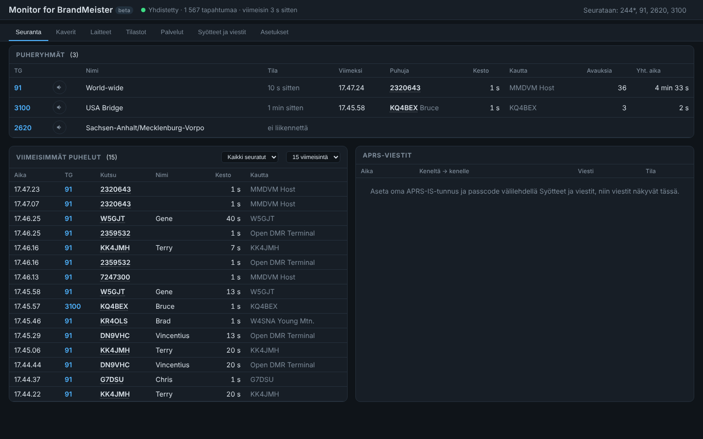
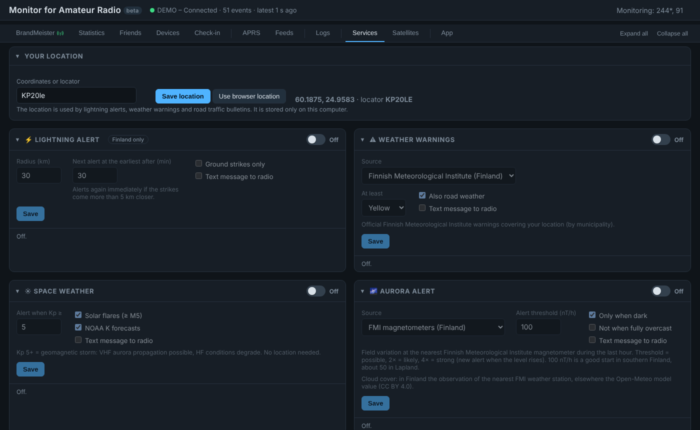

# Monitor for BrandMeister

[](https://github.com/hannulma/monitor-for-amateur-radio/releases)
[](https://github.com/hannulma/monitor-for-amateur-radio/actions/workflows/ci.yml)
[](LICENSE)

**An unofficial desktop monitor for the [BrandMeister](https://brandmeister.network) DMR network** – follow
talkgroup activity in real time, listen to talkgroups, get alerts when friends come on the air, watch your
repeaters and hotspots, and receive weather, space-weather, traffic and other open-data alerts on your
DMR radio via APRS.

🇫🇮 **[Suomenkielinen ohje → README.fi.md](README.fi.md)**

> [!NOTE]
> **Beta.** The core features are tested against the live BrandMeister network, but some features have had
> limited real-world testing. Bug reports and feedback are very welcome in
> [Issues](https://github.com/hannulma/monitor-for-amateur-radio/issues).
> The user interface is currently in **Finnish**; an English UI is planned.



## Features

- **Talkgroup monitor** – watch talkgroups by number or wildcard (`244*`, `2441?`): who is talking right now,
  last activity, duration, via which repeater/hotspot, number of calls and total airtime.
- **Live audio** – listen to one or several talkgroups directly in the app (Hoseline audio stream), with the
  current talker, talker alias and level meter.
- **Friend alerts** – desktop notification, sound and/or a DMR text message when a station on your list
  keys up anywhere on the network.
- **Station card** – click any callsign for registry data, APRS SSID, repeaters/hotspots and where and when
  the station was last heard.
- **Repeater & hotspot watch** – online/offline alerts, static and dynamic talkgroups, last traffic. With a
  BrandMeister API key you can also add/remove static talkgroups, drop dynamic groups, drop the current call
  or reset the connection of *your own* devices.
- **Check-in nets** – log weekly check-in nets (e.g. FinDMR TG 244, Estonia TG 248, Worldwide TG 91). Stations
  keying up in the net talkgroup appear in order of arrival and **rows never move**, even when traffic overlaps;
  overlapping keyups are marked, and a notice above the log shows when an already logged station transmits again. Click **Heard – log** (or type part of the callsign and press Enter) to give the
  station the next log number. The log uses the FinDMR sheet columns (NRO, callsign, RPT/HOTSPOT, KUNTA,
  Lisätietoja, Oper); RPT/HOTSPOT comes from the BrandMeister device (repeater callsign and city, or TetraPack / POC / Fusion / Open DMR / Hotspot by link type). With the optional
  [Google Sheets script](sheets/README.md) entries go straight into the shared sheet and several operators can
  log at once (personal keys via one-time pairing codes, signed requests); without it, **Copy new rows** puts
  the rows on the clipboard ready to paste. Finished rounds are saved as CSV.
- **Statistics** – activity per hour/day, top talkers, busiest talkgroups, and BrandMeister's own per-talkgroup
  user history.
- **APRS messaging** – see all APRS messages to and from every SSID of your callsign (including DMR ↔ APRS
  messages through the BrandMeister APRS gateway) and reply directly from the app.
- **Radio commands** – send `TG244`, `WHO`-style queries (`KUKA OH2ABC`), `NYT` (now active) or feed commands
  from your DMR radio and get the answer back as a text message.
- **News feeds → DMR SMS** – new RSS/Atom/JSON Feed items sent to your radio as short text messages.
- **Open-data alert services** (each with its own on/off switch):

  | Service | Source |
  |---|---|
  | ⚡ Lightning near you | Finnish Meteorological Institute (FMI) open data |
  | ⚠ Official weather warnings for your exact location | FMI CAP warnings |
  | ☀ Space weather (Kp index, solar flares) | NOAA SWPC |
  | 🌌 Local aurora alert (magnetometers, darkness and cloud cover aware) | FMI magnetometer network |
  | ☢ Radiation monitoring | STUK (Radiation and Nuclear Safety Authority of Finland) |
  | 🚧 Road traffic announcements by radius, region or road number | Fintraffic Digitraffic |

  Messages are condensed to fit a single 67-character APRS/DMR text message, e.g.
  `Tie 101 Espoo, Kalevalantie: Liikennevalot, epäkunnossa` or
  `Keltainen liikennesää: lumi/räntä, to 14–pe 12 (30 %)`.

- **English and Finnish** – choose the language in Settings. It covers the user interface, the program's own
  alerts and the replies sent to your radio (radio commands work in both languages: `HELP`/`APUA`, `WHO`/`KUKA`,
  `NOW`/`NYT`). FMI warnings and Digitraffic bulletins stay in Finnish, their source language.
- **Automatic updates** – the app checks GitHub for a new version once a day (can be turned off). On Windows
  (installer), macOS and Linux, **Update now** downloads the new version, verifies it against the release's
  `SHA256SUMS.txt`, installs it and restarts the app; the browser tab reconnects by itself. Beta users are
  offered new betas, stable users only stable releases.

Several services use Finnish open data and are most useful in Finland; the BrandMeister features work worldwide.



## Download

Get the latest version from **[Releases](https://github.com/hannulma/monitor-for-amateur-radio/releases)**:

| OS | File |
|---|---|
| Windows 10/11 | `MonitorForBrandMeister-<version>-windows-setup.exe` (installer) or `…-windows-portable.zip` |
| macOS 11+ (Intel and Apple Silicon M1–M4) | `MonitorForBrandMeister-<version>-macos-universal.dmg` |
| Linux x86_64 | `MonitorForBrandMeister-<version>-linux-x86_64.tar.gz` |
| Any OS with Python ≥ 3.9 | `pip install monitor_for_brandmeister-<version>-py3-none-any.whl` |

The app runs a small local web server and opens its user interface in your browser at
`http://127.0.0.1:8765/`. Nothing is exposed to your network. Starting the app again while it is running just
opens the page; use **Asetukset → Sulje ohjelma** (Settings → Quit) to stop it.

### First launch (unsigned builds)

The builds are not code-signed (signing certificates cost money for a hobby project):

- **Windows:** SmartScreen may say *“Windows protected your PC”* → click **More info → Run anyway**.
- **macOS:** open the `.dmg`, drag the app to *Applications*. On first launch macOS refuses to open it →
  open **System Settings → Privacy & Security** and click **Open Anyway** (or right-click the app → *Open*).
- **Linux:** `tar xzf MonitorForBrandMeister-*.tar.gz && ./monitor-for-brandmeister/monitor-for-brandmeister`

### Install with pip

```bash
pip install monitor_for_brandmeister-<version>-py3-none-any.whl   # from Releases
monitor-for-brandmeister            # or: python -m bmmonitor
```

Options: `--port 9000`, `--no-browser`, `--demo` (fake traffic, no network), `--diag` (show raw data from
BrandMeister), `-v` (verbose).

## Quick start

1. **Talkgroups:** *Asetukset* (Settings) → enter talkgroups separated by spaces, e.g. `244* 91 3100`.
   `*` matches any digits, `?` exactly one.
2. **Listen:** click the speaker button next to a talkgroup.
3. **Friends:** *Kaverit* → add callsigns or DMR IDs, allow desktop notifications.
4. **Devices:** *Laitteet* → add your hotspot/repeater by ID or search by callsign.
5. **Alerts on your radio (optional):** *Syötteet ja viestit* → set an APRS-IS login (your callsign with an
   unused SSID, e.g. `OH2ABC-13`) and the recipient = your radio's APRS SSID configured in
   BrandMeister SelfCare (e.g. `OH2ABC-7`), then *Send test message*.
6. **Services:** *Palvelut* → set your location (coordinates or Maidenhead locator) and switch on the services you want. Weather warnings can come from the Finnish Meteorological Institute or MeteoAlarm (38 European countries), and the aurora alert from FMI magnetometers or the NOAA OVATION forecast (worldwide). Satellite passes lists upcoming passes of the ISS and active amateur radio satellites (CelesTrak orbits, SatNOGS DB frequencies, SGP4) with visible ISS passes and alerts before rise. The *Satelliitit* tab shows the satellites chosen for alerts on a world map (position, ground track, coverage circle, day/night, next in-range window in the name tag) and a sky plot of the next pass. Base map: Natural Earth (public domain).

### Commands from your radio

Send a private text message to the BrandMeister APRS gateway of your country (*country code + 999*, e.g.
**244999** in Finland) in the form `<app APRS login> <command>`, e.g. `OH2ABC-13 TG244`.

| Command | Answer |
|---|---|
| `APUA` | list of commands |
| `TG244` | who is talking now / talked last, when and how long |
| `KUKA OH2ABC` | when and where the station was last heard |
| `NYT` | active transmissions in your monitored talkgroups |
| feed command, e.g. `SAA` | latest item of that feed |

Only your own callsign and the configured recipients may send commands by default.

## Privacy

Everything runs on your own computer. Settings, logs and statistics are stored locally:

- Windows: `%APPDATA%\BMMonitor\`
- macOS: `~/Library/Application Support/BMMonitor/`
- Linux: `~/.config/BMMonitor/`

Your optional BrandMeister API key and own APRS-IS passcode are kept in the operating system's keychain (Windows Credential Manager, macOS Keychain); where none is available, in `config.json` in that folder.

## Data sources and APIs

BrandMeister Last Heard (socket.io) and Halligan API v2, BrandMeister Hoseline audio, APRS-IS, FMI open data,
NOAA SWPC, STUK (via FMI open data), Fintraffic Digitraffic. See [docs/TECHNICAL.md](docs/TECHNICAL.md) for
endpoints, protocols and implementation notes.

Please be considerate with public services: the app uses conservative polling intervals and the same public
interfaces as the official web pages.

## Development

```bash
git clone https://github.com/hannulma/monitor-for-amateur-radio
cd monitor-for-amateur-radio
pip install -e ".[test]"
pytest
python -m bmmonitor --demo        # UI with fake traffic
```

**Releasing:** bump `__version__` in `bmmonitor/__init__.py` and push to `main`. When the version has not been
released yet, GitHub Actions builds the Windows installer, macOS disk
image (universal2: Intel and Apple Silicon), the Linux binary and the Python package, creates the tag `v<version>` and publishes a release
(versions like `0.9.0b1` are marked as pre-releases). Installed apps pick the new version up through the
built-in update check.

## Disclaimer

This is an independent hobby project and is **not affiliated with, endorsed by or supported by the
BrandMeister team**. BrandMeister is the name of its respective owners. Use the network and its interfaces
according to the [BrandMeister policies](https://wiki.brandmeister.network/index.php/Policies_and_Rules) and
your amateur radio licence.

## License

[MIT](LICENSE) © 2026 hannulma
